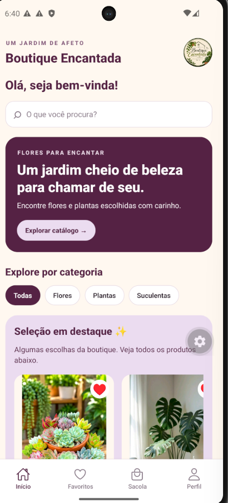
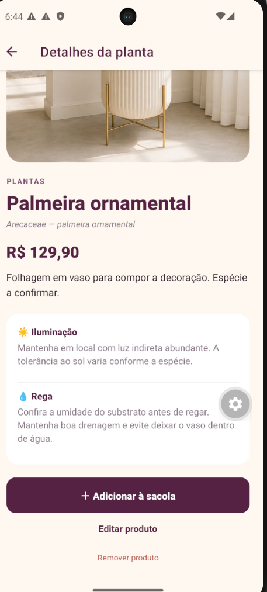
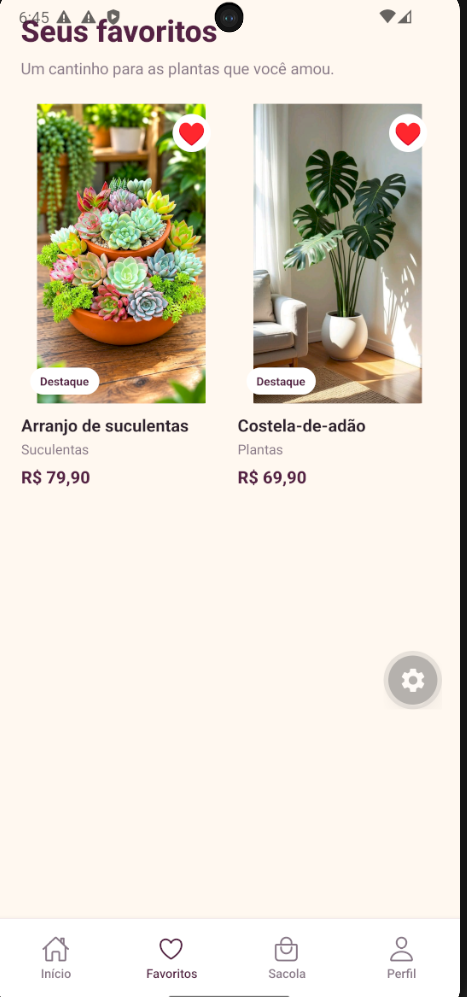
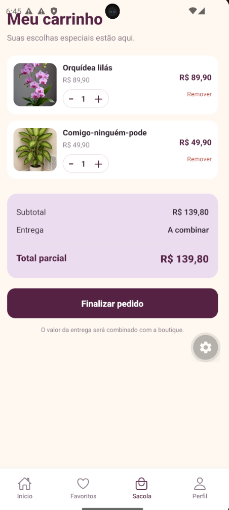
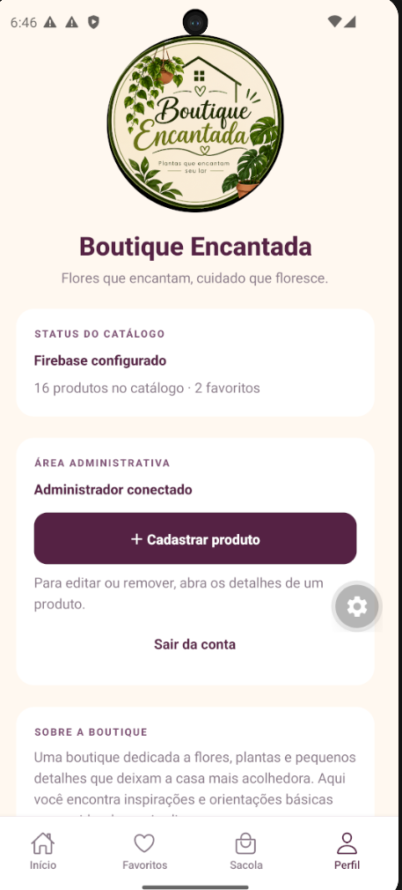
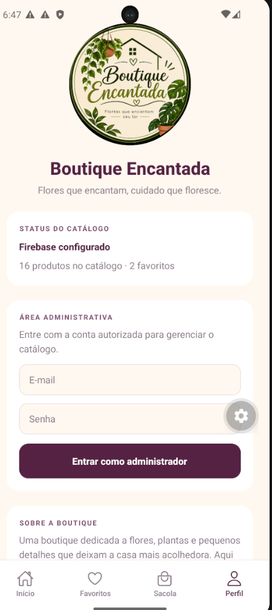

# Boutique Encantada 🌷

Aplicativo acadêmico de uma boutique de flores e plantas, desenvolvido para a disciplina de Programação para Dispositivos Móveis.

A proposta é reunir um catálogo visual, informações básicas de cuidado, favoritos e uma sacola de pedidos. A área administrativa permite cadastrar, editar e remover produtos com integração ao Firebase.

## Integrantes

- Carolaine Nunes Santos
- Manuella Carvalho Cunha de Oliveira
- Thiago Gonçalves de Medeiros

## Repositório

https://github.com/carolaine730/projeto-final-boutique-plantas

## Funcionalidades

- Catálogo inicial com 16 produtos.
- Busca por nome e filtros por categoria.
- Seção de produtos em destaque.
- Detalhes com foto, preço, descrição e cuidados.
- Favoritos e sacola persistidos com AsyncStorage.
- Alteração de quantidades e cálculo dos valores em centavos.
- Registro de pedidos no Cloud Firestore.
- Autenticação anônima para visitantes ao enviar pedidos.
- Login administrativo com e-mail e senha.
- Persistência da sessão administrativa no Android.
- Cadastro, edição e remoção lógica de produtos.
- Seleção de foto pela galeria do aparelho.
- Redimensionamento e compressão das fotos cadastradas.
- Controle de acesso administrativo nas telas e nas regras do Firestore.

## Tecnologias

- React Native 0.86
- React 19
- Expo SDK 57
- Expo Router: Stack e Bottom Tabs
- TypeScript
- Context API
- AsyncStorage
- Firebase Authentication e Cloud Firestore
- Expo Image Picker
- Expo Image Manipulator
- @expo/vector-icons

As versões exatas estão em `boutique-encantada/package.json` e no arquivo de lock.

## Capturas de tela

| Início | Detalhes |
|---|---|
|  |  |

| Favoritos | Sacola |
|---|---|
|  |  |

| Cadastro | Perfil |
|---|---|
|  |  |

## Instalação

### Pré-requisitos

- Node.js compatível com o Expo SDK 57 e npm.
- Git.
- Expo Go compatível com SDK 57.
- Android Studio com emulador, ou um aparelho Android.
- Acesso à internet para autenticação e operações no Firebase.

### Baixar e instalar

```bash
git clone https://github.com/carolaine730/projeto-final-boutique-plantas.git
cd projeto-final-boutique-plantas
cd boutique-encantada
npm ci
```

Se a versão final ainda estiver na branch de desenvolvimento, selecione-a antes de executar:

```bash
git switch feature/finalizacao
```

### Configurar o ambiente

Dentro de `boutique-encantada`, copie o exemplo:

```bash
cp .env.example .env
```

Preencha o `.env` com a configuração do aplicativo Web registrado no Firebase:

```env
EXPO_PUBLIC_FIREBASE_API_KEY=valor_do_projeto
EXPO_PUBLIC_FIREBASE_AUTH_DOMAIN=valor_do_projeto
EXPO_PUBLIC_FIREBASE_PROJECT_ID=valor_do_projeto
EXPO_PUBLIC_FIREBASE_STORAGE_BUCKET=valor_do_projeto
EXPO_PUBLIC_FIREBASE_MESSAGING_SENDER_ID=valor_do_projeto
EXPO_PUBLIC_FIREBASE_APP_ID=valor_do_projeto
```

A configuração está disponível no console do Firebase, em Configurações do projeto → Seus aplicativos.

O `.env` não é versionado. As variáveis `EXPO_PUBLIC_*` são incorporadas ao aplicativo; a autorização de acesso ao banco é feita pelas regras do Firestore.

Reinicie o Expo depois de modificar essas variáveis.

## Configuração do Firebase

Para usar um projeto Firebase próprio:

1. Crie um projeto no console do Firebase.
2. Registre um aplicativo Web para obter a configuração do SDK JavaScript.
3. Preencha o `.env` com os dados desse projeto.
4. Crie um banco Cloud Firestore na edição Standard.
5. Em Authentication, ative os métodos Anônimo e E-mail/senha.
6. Na aba Usuários, crie a conta administrativa.
7. Copie o UID dessa conta.
8. Substitua o `ADMIN_UID` em `src/services/admin.ts`.
9. Substitua também o UID da função `isAdmin()` em `firestore.rules`.
10. Copie as regras de `firestore.rules` para a aba Regras do Firestore e publique.

O UID do código e o UID das regras precisam corresponder à mesma conta.

Salvar `firestore.rules` no computador não publica as regras automaticamente.

Para usar o projeto Firebase da equipe, solicite a configuração de teste e o acesso administrativo diretamente aos responsáveis. Senhas não devem ser incluídas no repositório.

### Catálogo

Os 16 produtos iniciais ficam em `src/data/plants.ts`, com fotos empacotadas no aplicativo.

A coleção `plants` contém novos produtos, edições e registros de remoção. O aplicativo combina esses documentos com o catálogo inicial:

- Um novo ID adiciona um produto.
- Um ID existente substitui as informações do produto local.
- Um documento com `deleted: true` oculta o produto.

A remoção é lógica. O registro permanece no Firestore para impedir que um produto do catálogo inicial reapareça ao reabrir o aplicativo.

### Pedidos

A coleção `orders` é criada quando um pedido é enviado com sucesso.

Cada pedido contém:

- `userId`: UID do usuário autenticado.
- `items`: produtos, quantidades e valores.
- `total`: valor total dos produtos.
- `createdAt`: data e hora do servidor.
- `status`: inicialmente `recebido`.

As regras permitem que visitantes autenticados criem pedidos vinculados ao próprio UID. A leitura é permitida ao proprietário e ao administrador.

### Fotos cadastradas

As fotos selecionadas são convertidas para JPEG, reduzidas e salvas como uma string de imagem no documento do produto.

O formulário limita a string a 280.000 caracteres. Essa solução atende ao catálogo acadêmico pequeno e não utiliza Firebase Storage.

Para um catálogo comercial maior, recomenda-se migrar as imagens para um serviço de armazenamento de arquivos.

## Execução

Execute os comandos dentro de `boutique-encantada`.

### Android

```bash
npx expo start --lan --port 8083
```

Inicie o emulador e pressione `a` no terminal do Expo.

Em aparelho físico, conecte o computador e o celular à mesma rede e leia o QR code com o Expo Go compatível.

### Navegador

```bash
npx expo start --web --port 8083
```

### Limpar cache

Se houver erro após atualizar dependências, encerre o Expo com Ctrl + C, feche o Expo Go e execute:

```bash
npx expo start --lan --clear --port 8083
```

No ambiente Windows usado pela equipe, o modo LAN resolveu um problema em que `localhost` escutava apenas em IPv6.

### Verificações

```bash
npx tsc --noEmit
npx expo install --check
npm audit
```

Não utilize `npm audit fix --force` sem avaliar as alterações propostas e a compatibilidade com o SDK.

## Modo demonstração

Sem as variáveis mínimas do Firebase, o aplicativo abre com o catálogo inicial e persistência local de favoritos e sacola.

Nesse modo, o envio de pedidos e o gerenciamento administrativo não ficam disponíveis.

## Organização do código

Os caminhos abaixo são relativos à pasta `boutique-encantada`:

| Caminho | Responsabilidade |
|---|---|
| `app/(tabs)` | Início, favoritos, sacola e perfil |
| `app/plant/[id].tsx` | Detalhes e controles administrativos do produto |
| `app/admin/new.tsx` | Cadastro e edição com validação e galeria |
| `app/_layout.tsx` | Navegação Stack e provedor global |
| `src/components/PlantCard.tsx` | Cartão reutilizável de produto |
| `src/data/plants.ts` | Tipos, categorias e catálogo inicial |
| `src/data/productImages.ts` | Associação dos produtos às imagens locais |
| `src/services/firebase.ts` | Inicialização do Firebase |
| `src/services/authClient.native.ts` | Persistência de autenticação no Android |
| `src/services/admin.ts` | Identificação do administrador e estado de acesso |
| `src/state/Store.tsx` | Context API, sacola, favoritos e operações no Firestore |
| `src/theme.ts` | Cores do aplicativo |
| `firestore.rules` | Regras de acesso ao banco |

## Testes manuais realizados

Os fluxos abaixo foram testados pela equipe no navegador e no emulador Android, conforme aplicável:

- Consulta e filtragem do catálogo.
- Abertura dos detalhes e exibição da foto inteira.
- Inclusão e persistência de favoritos.
- Inclusão, alteração de quantidade e remoção na sacola.
- Envio de pedido ao Firebase e esvaziamento da sacola.
- Login e saída da conta administrativa.
- Persistência do login após fechar e reabrir no Android.
- Cadastro e edição de produto.
- Remoção de produto e manutenção da remoção após reabrir.
- Ocultação dos controles administrativos após sair.
- Seleção pela galeria nativa.
- Persistência da foto cadastrada após reabrir o aplicativo.

Esses registros representam testes manuais, não uma suíte automatizada.

## Limitações conhecidas

- Projeto acadêmico demonstrativo, sem processamento de pagamento.
- Pagamento e entrega são apenas mencionados como combinação posterior.
- O pedido não coleta dados de contato do comprador.
- Valores do pedido são calculados no cliente e não recalculados por um backend.
- Preços são fictícios.
- As identificações botânicas são referências gerais do catálogo.
- Fotos incorporadas aos documentos são destinadas a um catálogo pequeno.
- Na auditoria realizada em 18/11/2026, permaneceram 33 alertas de dependências, sendo 2 moderados e 31 altos. As atualizações compatíveis aplicadas não eliminaram todos os alertas; a avaliação e correção permanecem pendentes.
- O funcionamento no iOS não foi validado.

## Versionamento

O repositório utiliza as branches:

- `main`: destinada à versão estável da entrega.
- `develop`: integração das funcionalidades.
- `feature/*`: desenvolvimento das funcionalidades.

As alterações devem ser enviadas por Pull Request, com revisão de outro integrante antes da integração em `develop`.

O histórico de commits e os Pull Requests ficam disponíveis no GitHub para consulta.

## Apresentação

A demonstração será realizada em sala por Manuella e Thiago.

Roteiro:

1. Apresentar a proposta, o público-alvo e os integrantes.
2. Mostrar o catálogo, a busca e os filtros.
3. Abrir um produto, favoritar e adicionar à sacola.
4. Alterar quantidades e enviar um pedido.
5. Mostrar o pedido registrado no Firestore.
6. Entrar como administrador.
7. Demonstrar cadastro com galeria, edição e remoção.
8. Explicar Context API, navegação, persistência e regras de acesso.
9. Mostrar o histórico do repositório e os Pull Requests.